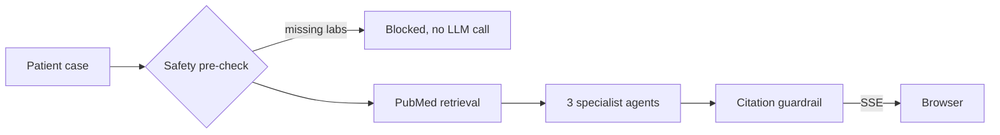

# Cancer to Hell

Three LLM agents (evidence, guideline, safety) review a synthetic breast cancer case, ground their answers in PubMed abstracts retrieved for that case, and stream results to the browser. Any citation the model invents is caught before the user sees it.

I built it end to end: Go backend, agent prompts, PubMed retrieval, citation guardrail, Next.js frontend, and deployment.

**Live:** https://cancer-to-hell.vercel.app

> Research and educational use only. Not a medical device. Use synthetic patient data only.

## How it works



## Key decisions

- **Citations are checked in code, not trusted.** Every PMID in the output is matched against the papers actually retrieved. Fake ones become `[unverified]`.
- **Every claim shows its source.** Retrieved papers cite as `(Author et al., Year. PMID: …)`; the model's own knowledge is tagged `(Gemini)`.
- **Bad input costs nothing.** Missing labs are caught before any API call.
- **Concurrency vs. rate limits.** The synchronous endpoint runs the agents in parallel as goroutines. On the streaming endpoint, parallel calls hit the Gemini free-tier rate limit, so they run one after another and each result streams as soon as it's ready.

## Testing and status

- 7 unit tests cover the citation guardrail and reference formatting: `cd backend && go test ./...`
- An evaluation against NCCN guidelines is in progress in [`eval/`](eval/).
- Limits: synthetic cases only, breast cancer only, no clinical validation.

## Stack

Go + Gin · Next.js + Tailwind · Gemini 2.5 Flash Lite · NCBI PubMed API · Fly.io + Vercel

## Run locally

```bash
cd backend && echo "GOOGLE_API_KEY=your-key" > .env && go run .        # API on :8080
cd frontend && npm install && NEXT_PUBLIC_BACKEND_URL=http://localhost:8080 npm run dev
```

---

Built by **Huynh (Heidi) Ho** · [Website](https://huynna12.github.io) · [LinkedIn](https://linkedin.com/in/heidi-ho-16b875246) · MIT License
